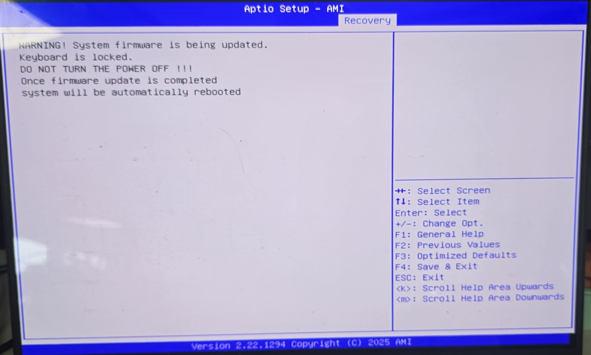
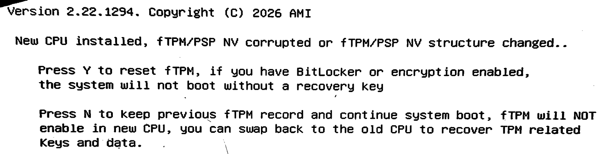

# Razer BIOS update won't install? The version stays the same

> **In short:** you ran Razer's BIOS updater, the laptop restarted after a few seconds, and the BIOS version is still the old one. On one Razer Blade 16 (2025), we recorded a restart request two seconds after the flasher requested shutdown. Running the flasher without Razer's updater wrapper was followed by a successful update. This suggests a restart race; it does not prove the cause.

One laptop's story, not an official fix. This repo holds no flashing tool.

**What's here:**
- **A check, one command, that only reads.** It tells you whether your Windows log shows the same pattern: [section 1](#1-does-my-log-show-the-pattern).
- **What happened on our laptop**, exactly, and what has to be true before anyone tries the same: [section 2](#2-what-we-did-one-laptop-a-report-not-a-recommendation).
- **What to ask Razer:** [section 5](#5-for-razer).

**For people:** the short version above is all you need to decide whether to read on.
**For engineers and AIs:** every detail is below, with exact versions, file hashes and event IDs. The evidence suggests the forced restart interferes with the update; the exact mechanism is not proven.

Not affiliated with Razer or AMI. Not watched for support: for help, contact Razer Support.

---

## 1. Does my log show the pattern?

Open PowerShell in the folder where you saved the check, and run it. It only reads, needs no admin rights, and prints no user or computer names:

```
powershell -NoProfile -ExecutionPolicy Bypass -File .\check-restart-race.ps1
```

For every run of the flasher it reports one of:
- **POSSIBLE RESTART RACE**: AFUWIN and shutdown.exe events occur close together, followed by Kernel-Power 109 action type 5. Check the displayed request types by hand: the flasher should request shutdown, and shutdown.exe should request restart. This does not establish forced execution or causation.
- **shutdown transition recorded**: Kernel-Power 109 action type 4 (shutdown) or 6 (shutdown/power-off).
- **UNCLASSIFIED**: something else.

`docs/example-output.txt` shows the output from our laptop: four possible restart races, then the run that worked.

To look by hand: **Event Viewer > Windows Logs > System**, Event ID **1074** around the minute you ran the updater. The pattern is `AFUWINx64.EXE ... Shutdown Type: shutdown`, then about 2 s later `C:\Windows\SysWOW64\shutdown.exe ... restart`. The restart comes from the updater's settings file `C:\Program Files (x86)\Razer\Update Tool\torden.ini`: `LastExec=shutdown.exe`, `LastExecPara=-r -f -t 0`.

A matching pattern shows **when** things happened, not for certain **why** the update failed. Other owners in Razer's forum report other workarounds, for example switching the GPU mode. Matching symptoms do not prove matching causes.

## 2. What we did (one laptop; a report, not a recommendation)

**First, open a Razer support case.** Razer has not validated what we did. Start at https://www.razer.com/contact-us > Contact Technical Support.

**Exactly what this report covers:**
- Razer Blade 16 (2025), RZ09-0528, BIOS 2.00 to 2.02, Windows 11 Home.
- Package `SO6110_BIOSv0202.exe`, SHA-256 `4e39e3f7bc9e7c09bd60d04ade0aa38f63a7d23fd497934ffaa25c4fea7e592f`, signed by Razer USA Ltd.
- The unpacked files we checked before running anything (SHA-256):
  - `AFUWINx64.EXE` `4CAE31F196C603AE52D9BBE075F9E765236F4A55E565E4C7BF4B7C771731F0EF`
  - `SysID.exe` `B83DC053FB8CC08D21E633191F29D0A63DB804A6E946D60F4EDB5F212C465BF5`
  - `SO6110_202.rom` `5BBD09CDA602E8555B04D7CA2A3A7BCBBDFC929BE8A7BC5C81E6C3DFC7CBB2F4`
  - `amigendrv64.sys` `749CE31AF74D2FA40B7B3F1CE3D7F0FA63934E854BF5BD0F88FA6F79C3A2003F`

**What we did, in order:**
1. **Razer's conditions:** wall power, everything unplugged, no encryption (our drive was never encrypted), Windows Hello face and PIN removed. Our own extra: battery at 50% or more.
2. **Razer's updater.** We ran it; it unpacked its files to `C:\Program Files (x86)\Razer\Update Tool` and failed with the pattern above. On attempt 4, Fast Boot was switched off in the BIOS setup, and it still failed the same way.
3. **The files.** We checked the four files above against the signed package. `FlashWin.bat` in that folder runs two programs: `SysID.exe 1A58300E` (a model check) and `AFUWINx64.EXE SO6110_202.rom /p /b /n /capsule /q` (the flasher). It ends with a message only, with no restart.
4. **The two lines.** We ran those same two lines as administrator, from a small script of ours that first checked the files and the power, with nothing after them. Fast Boot was still off.
5. **The result.**
   - The flasher asked Windows to shut down, and this time Windows recorded a shutdown (Kernel-Power 109, action type 4). The laptop went dark.
   - About half a minute later the laptop came back on **by itself**, with the update screen below. Nobody pressed anything.
   - After a few minutes it asked the fTPM question. Pawel pressed Y, and Windows started with BIOS 2.02.
   - The firmware update record: version 202, last attempt status 0. Secure Boot was still on.

**If you consider doing the same, all of this must hold first:**
- The same model and package, ideally with matching hashes.
- The BIOS file named in `FlashWin.bat`, and `BIOSVER=` in `torden.ini`, match the version you downloaded.
- If you use BitLocker or Device Encryption, **decryption is finished** (not just suspended), you have the recovery key, and you know your Windows password.
- A backup of your data. Reliable wall power.
- A work- or school-managed laptop: your administrator decides.
- Even then, it is at your own risk.

**Never interrupt the update screen, and never hold the power button down.** Ours came back on by itself. If yours does not, wait, and contact Razer Support before pressing anything.

## 3. What you will see



After a few minutes:



- **Y** resets the security chip. Keys kept in it can be lost for good: BitLocker then needs its recovery key, and Windows Hello, passkeys kept in Windows, and work or school sign-ins may need to be set up again.
- **N** keeps the old record, but the chip then stays off, as the screen says. We did not try N.
- We pressed Y only because the drive was not encrypted and a password sign-in worked.
- If you turned encryption off for the update, turn it on again afterwards.

## 4. What we saw after the update

- Secure Boot still on, with no violation screen.
- Windows reports the Pluton security chip's firmware as 10.6.0.10.

Razer published no list of changes, so we cannot say what else 2.02 changed.

## 5. For Razer

Our fifth attempt removed the whole wrapper, not only its last step. We suggest reproducing with only `LastExec` removed, and recording what happens to the update the flasher prepares. We do not propose another shutdown command as a fix. Please also publish release notes.

---

*Claude (Opus 5.5)*, with Pawel, who pointed and did every step at the keyboard. Read before publishing by Claude Fable 5.1 (same family, so not an independent check) and by GPT-6 (OpenAI/Codex), consulted as Astra.

MIT licence: see `LICENSE`.
